# Beyond the Code

Companion repository for the talk **“Beyond the Code: KI-Modelle mit KServe und GPUs in Kubernetes orchestrieren”**.

It takes you from an empty Akamai Cloud (Linode) account to a .NET application that talks to
open-weight models running on your own GPUs:

1. **Provision** an LKE cluster with a GPU node pool, the NVIDIA GPU Operator, KServe and a Gateway API controller (NGINX Gateway Fabric) — with Terraform *or* Pulumi (C#).
2. **Serve** two open-weight models with KServe: an LLM on the GPU and an embedding model on CPU.
3. **Ship** a .NET app to the same cluster that uses both models through `Microsoft.Extensions.AI`, exposed through a Gateway.

By default the app is served over plain HTTP on the Gateway's IPv4 address, so no domain is needed.
HTTPS with your own domain and Let's Encrypt is an add-on: [docs/https-with-custom-domain.md](docs/https-with-custom-domain.md).

```
.
├── iac/                    Infrastructure as Code (pick one)
│   ├── terraform/
│   │   ├── 01-cluster/     LKE cluster, CPU pool, GPU pool
│   │   └── 02-platform/    Gateway API + NGINX Gateway Fabric, cert-manager, NVIDIA GPU Operator, KServe
│   └── pulumi/             The same in C#, as one Pulumi program
├── manifests/              Kubernetes manifests, applied with kubectl (or GitOps)
│   ├── models/             KServe InferenceServices + NetworkPolicy
│   ├── gateway/            Gateway "public": the HTTP entry point (raw IPv4)
│   ├── app/                The .NET app: Deployment, Service, HTTPRoute
│   ├── observability/      Standalone Aspire dashboard (OTLP traces, metrics, logs)
│   └── https/              Add-on: HTTPS listener + Let's Encrypt for your own domain
├── src/                    .NET solution
│   └── Api/                ASP.NET Core minimal API: /ask (streaming chat), /search (semantic search)
├── .github/workflows/      CI: builds the API and publishes its image to GHCR
├── scripts/                Helper scripts used in the demos
├── demo/                   Request payloads for the demos
├── docs/                   Add-on guides (HTTPS with your own domain)
└── assets/                 Images for the docs (architecture diagram)
```

## Architecture

<p align="center">
  
</p>

Only the .NET app is exposed, and only through the Gateway. The models are reachable inside the
cluster only, and a NetworkPolicy allows traffic to them from the `app` namespace alone.

## Prerequisites

| Tool | Used for |
|---|---|
| Terraform ≥ 1.6 (or OpenTofu) **or** Pulumi CLI | Provisioning |
| .NET SDK 10 | Pulumi program, the app, container image build |
| kubectl | Deploying models and the app |
| Docker (or Podman) | Registry login for pushing the app image |
| linode-cli (optional) | Looking up Kubernetes versions and GPU plans |

> **Cost warning:** GPU nodes are billed by the hour whether they are busy or not.
> Run the teardown at the end of the day.

## Credentials

You need **two** credentials, plus a third if you use Pulumi. Nothing else is required.

| Credential | Needed for | Required? |
|---|---|---|
| Akamai Cloud personal access token | Creating the cluster and node pools | Always |
| Container registry token (e.g. GitHub PAT) | Pushing the app image; pulling it if the image is private | Always (step 3) |
| Pulumi access token **or** a passphrase | Pulumi state and encrypting the `kubeconfig` output | Option B only |
| Hugging Face token | Gated models, higher download rate limits | Optional |

**Not needed:** an OpenAI (or any other AI provider) API key. The app talks to *your* models; the
`Inference:ApiKey` setting is a dummy value that the OpenAI SDK requires and KServe ignores.

### 1. Akamai Cloud personal access token

Create it in Cloud Manager → your profile → **API Tokens** → **Create a Personal Access Token**.

- **Scope:** `Kubernetes` → **Read/Write** is enough. The create-cluster API needs only `lke:read_write`;
  node pools and the kubeconfig are part of the same API.
- Your user must also be allowed to create LKE clusters (on accounts with role-based access control:
  the `account_lkecluster_creator` role).
- Add `Linodes` → **Read Only** if you want `linode-cli` to list your nodes.
- Set an expiry date that covers your talk and no longer.

```bash
export LINODE_TOKEN=<token>          # read by Terraform, Pulumi and linode-cli
export LINODE_CLI_TOKEN=$LINODE_TOKEN # optional, for linode-cli without running `linode-cli configure`
```

The Gateway's NodeBalancer is created by LKE's own cloud controller with the cluster's credentials,
so your token doesn't need NodeBalancer permissions. Only the HTTPS add-on needs one more scope
(`Domains` → **Read/Write**) if you create the DNS record with `linode-cli`.

### 2. Container registry (GitHub Container Registry in the examples)

Create a GitHub **personal access token (classic)** with the `write:packages` scope (it includes
`read:packages`), then log in. `dotnet publish -t:PublishContainer` uses the same credentials as Docker:

```bash
echo <github-pat> | docker login ghcr.io -u <github-user> --password-stdin
```

New GHCR packages are **private**. After the first push, either make the package public
(GitHub → your profile → Packages → `beyond-the-code-api` → Package settings → Change visibility), or
give the cluster a pull secret:

```bash
kubectl create namespace app --dry-run=client -o yaml | kubectl apply -f -
kubectl create secret docker-registry ghcr -n app \
  --docker-server=ghcr.io --docker-username=<github-user> --docker-password=<github-pat-with-read:packages>
kubectl patch serviceaccount default -n app -p '{"imagePullSecrets":[{"name":"ghcr"}]}'
```

### 3. Pulumi state (Option B only)

The stack output `kubeconfig` is a secret, so Pulumi needs somewhere to keep state and a way to encrypt it.
Pick one:

```bash
# Pulumi Cloud (free for individuals): token from app.pulumi.com → Personal access tokens
export PULUMI_ACCESS_TOKEN=<token>

# …or keep state on your machine, encrypted with a passphrase
pulumi login --local
export PULUMI_CONFIG_PASSPHRASE=<passphrase>
```

Instead of the `LINODE_TOKEN` environment variable you can also store the Linode token in the stack:
`pulumi config set --secret linode:token <token>`.

### 4. Hugging Face token (optional)

Both models are public and ungated (`Qwen/Qwen3-4B-Instruct-2507` is Apache-2.0,
`intfloat/multilingual-e5-small` is MIT), so no token is needed. If you switch to a gated model (e.g. Llama)
or hit download rate limits, create a **Read** token at huggingface.co → Settings → Access Tokens and pass it
to the model server:

```bash
kubectl create secret generic hf-token -n models --from-literal=HF_TOKEN=<token>
```

```yaml
# in manifests/models/<model>.yaml, under spec.predictor.model:
      env:
        - name: HF_TOKEN
          valueFrom: { secretKeyRef: { name: hf-token, key: HF_TOKEN } }
```

### Generated credentials (keep them private)

- `./kubeconfig.yaml`, written by `scripts/kubeconfig.sh`, holds a **cluster-admin token**. It's git-ignored;
  never commit or share it.
- Terraform state (`iac/terraform/*/terraform.tfstate`) contains the same kubeconfig in plain text. It's
  git-ignored too; use an encrypted remote backend if more than one person works on this.

## 1 · Provision the cluster and platform

Pinned versions (November 2026): KServe `v0.21.0`, cert-manager `v1.21.3`, NVIDIA GPU Operator `v26.7.3`,
NGINX Gateway Fabric `2.9.0`, Gateway API CRDs `v1.7.0`.
Check available Kubernetes versions and GPU plans before your first run:

```bash
linode-cli lke versions-list
linode-cli linodes types --text | grep -i gpu
```

### Option A: Terraform

```bash
export LINODE_TOKEN=...

cd iac/terraform/01-cluster
cp terraform.tfvars.example terraform.tfvars   # adjust region, versions, plans
terraform init && terraform apply

cd ../02-platform
terraform init && terraform apply

cd ../../..
./scripts/kubeconfig.sh terraform
```

The two root modules are separate on purpose: the platform layer reads the cluster’s
kubeconfig from the cluster layer’s state, so Helm never needs a cluster that does not exist yet.

### Option B: Pulumi (C#)

```bash
export LINODE_TOKEN=...

cd iac/pulumi
pulumi stack init dev          # Pulumi.dev.yaml holds the (non-secret) config
pulumi up

cd ../..
./scripts/kubeconfig.sh pulumi
```

Both options produce the same result and write `./kubeconfig.yaml` (git-ignored).

```bash
export KUBECONFIG=$PWD/kubeconfig.yaml
kubectl get nodes -L nvidia.com/gpu.product
kubectl describe nodes | grep nvidia.com/gpu
kubectl get gatewayclass nginx          # ACCEPTED: True
```

## 2 · Serve the models

```bash
kubectl apply -f manifests/models/
kubectl get inferenceservices -n models -w
kubectl logs -n models -f -l serving.kserve.io/inferenceservice=qwen
```

| Model | Runs on | Endpoint (inside the cluster) |
|---|---|---|
| [`Qwen/Qwen3-4B-Instruct-2507`](https://huggingface.co/Qwen/Qwen3-4B-Instruct-2507) (Apache-2.0) | GPU pool, vLLM | `http://qwen-predictor.models.svc.cluster.local/openai/v1` |
| [`intfloat/multilingual-e5-small`](https://huggingface.co/intfloat/multilingual-e5-small) (MIT) | CPU pool | `http://embed-predictor.models.svc.cluster.local/openai/v1` |

Call the LLM without any .NET code:

```bash
./scripts/port-forward.sh            # qwen → localhost:8081, embed → localhost:8082
./scripts/smoke-test.sh
```

## 3 · Ship the .NET app

The app in `src/Api` runs in the same cluster as the models. Getting it there takes four things: an
image in a container registry, permission for the cluster to pull it, the Kubernetes manifests, and the
Gateway that makes it reachable. The examples use the GitHub Container Registry (`ghcr.io`); any OCI
registry works.

### 3.1 Log in to the registry (once)

Create a GitHub personal access token (classic) with `write:packages`, as described under
[Credentials → Container registry](#2-container-registry-github-container-registry-in-the-examples), then:

```bash
echo "$GITHUB_PAT" | docker login ghcr.io -u <github-user> --password-stdin
```

The .NET SDK reuses these Docker credentials when it pushes. Building doesn't need a running Docker daemon.

### 3.2 Build and push the image

```bash
export REGISTRY=ghcr.io/<github-user>
export TAG=1.0.0
./scripts/build-image.sh "$TAG"
```

`build-image.sh` runs `dotnet publish -t:PublishContainer`: the .NET SDK builds the image without a
Dockerfile and pushes it to `$REGISTRY/beyond-the-code-api:$TAG`. It builds for `linux/x64` on purpose,
because LKE nodes are x64; an image built for your arm64 Mac would crash on the nodes.

Check that the image arrived: GitHub → your profile → **Packages** → `beyond-the-code-api`.

**Or let GitHub Actions do it.** Once the repository is on GitHub,
[`.github/workflows/api-image.yml`](.github/workflows/api-image.yml) builds and pushes the image for you,
authenticated with the workflow's own `GITHUB_TOKEN` (no personal access token, and no step 3.1):

| Event | Result |
|---|---|
| Pull request touching `src/` | Compiles only; nothing is pushed |
| Push to `main` touching `src/` | `ghcr.io/<owner>/beyond-the-code-api:sha-<short-sha>` and `:latest` |
| Tag `v1.2.3` | `ghcr.io/<owner>/beyond-the-code-api:1.2.3` and `:latest` |
| Manual run (Actions → API image → Run workflow) | Same as a push to `main` |

The run summary shows the exact `kubectl set image` command for the image it pushed. Use the
`sha-…` or version tag in the Deployment rather than `latest`, so you always know which build runs.

### 3.3 Let the cluster pull the image

New GHCR packages are **private**, and the cluster has no GitHub credentials. Pick one:

- **Make the package public** (simplest for a demo): GitHub → Packages → `beyond-the-code-api` →
  **Package settings** → **Change visibility** → Public.
- **Or give the cluster a pull secret** (keeps the image private):

  ```bash
  kubectl create namespace app --dry-run=client -o yaml | kubectl apply -f -
  kubectl create secret docker-registry ghcr -n app \
    --docker-server=ghcr.io --docker-username=<github-user> --docker-password=<pat-with-read:packages>
  kubectl patch serviceaccount default -n app -p '{"imagePullSecrets":[{"name":"ghcr"}]}'
  ```

Skip this step and the pods end up in `ImagePullBackOff`.

### 3.4 Deploy the Gateway, the dashboard and the app

```bash
# Public entry point: a Gateway with an HTTP listener (provisions a NodeBalancer)
kubectl apply -f manifests/gateway/

# Aspire dashboard, so the app has somewhere to send traces
kubectl apply -f manifests/observability/

# Point the Deployment at your image (first time only), then deploy
sed -i.bak "s#ghcr.io/OWNER/beyond-the-code-api:1.0.0#$REGISTRY/beyond-the-code-api:$TAG#" manifests/app/deployment.yaml
rm manifests/app/deployment.yaml.bak
kubectl apply -f manifests/app/
kubectl rollout status deployment/api -n app --timeout=3m
```

`manifests/app/` contains the namespace, the Deployment (2 replicas), a cluster-internal Service, and the
HTTPRoute that attaches the app to the Gateway, plus a policy that keeps `/ask` streaming through NGINX.
The Deployment already points the app at the models' in-cluster addresses
(`http://qwen-predictor.models.svc.cluster.local/openai/v1` and the `embed` equivalent).

### 3.5 Open it

```bash
# The Gateway's public IPv4 address (can take a minute or two to appear)
GATEWAY_IP=$(kubectl get gateway public -n gateway -o jsonpath='{.status.addresses[0].value}')
APP=http://$GATEWAY_IP
echo $APP

curl $APP/healthz
curl -N $APP/ask    -H 'content-type: application/json' -d @demo/ask.json
curl    $APP/search -H 'content-type: application/json' -d @demo/search.json
```

Or open `http://<GATEWAY_IP>/` in a browser. Traces are in the Aspire dashboard:

```bash
kubectl port-forward -n observability svc/aspire-dashboard 18888:18888
open http://localhost:18888
```

### 3.6 Ship a new version

```bash
./scripts/build-image.sh 1.0.1
kubectl set image deployment/api api=$REGISTRY/beyond-the-code-api:1.0.1 -n app
kubectl rollout status deployment/api -n app
```

Update the tag in `manifests/app/deployment.yaml` as well, so a later `kubectl apply` doesn't roll back.

### Troubleshooting

| Symptom | Likely cause | Fix |
|---|---|---|
| `build-image.sh` fails with an authentication error on push | Not logged in, or the token lacks `write:packages` | Step 3.1 |
| `build-image.sh` complains about the repository name | Uppercase in the name | The script lowercases `REGISTRY`; check `ContainerRepository` if you changed it |
| Pod in `ImagePullBackOff`, event says `unauthorized` or `denied` | Package is private | Step 3.3 |
| Pod in `ImagePullBackOff`, event says `not found` | Image name or tag doesn't match | `kubectl get deployment api -n app -o jsonpath='{..image}'` |
| Pod in `CrashLoopBackOff` right away with `exec format error` | Image built for arm64 | Rebuild with `build-image.sh` (forces x64) |
| `/healthz` works, `/ask` returns 500 | A model isn't ready | `kubectl get inferenceservices -n models`; `kubectl logs deployment/api -n app` |
| `curl $APP` times out | Gateway has no address yet, or the route isn't attached | `kubectl get gateway public -n gateway`; `kubectl describe httproute api -n app` |

### Add-on: HTTPS with your own domain

To serve the app at `https://api.<your-domain>` with a Let's Encrypt certificate, follow
[docs/https-with-custom-domain.md](docs/https-with-custom-domain.md). It needs a DNS record and
`kubectl apply -f manifests/https/`; the controller and cert-manager are already set up for it.

### Run the app locally

```bash
./scripts/port-forward.sh &
dotnet run --project src/Api      # uses appsettings.Development.json → localhost:8081/8082
```

## Teardown

```bash
kubectl delete -f manifests/app/ -f manifests/models/ -f manifests/observability/
kubectl delete -f manifests/gateway/     # removes the Gateway's NodeBalancer
# Terraform
(cd iac/terraform/02-platform && terraform destroy) && (cd iac/terraform/01-cluster && terraform destroy)
# or Pulumi
(cd iac/pulumi && pulumi destroy)
```

Delete the Gateway before destroying the cluster, otherwise its NodeBalancer may outlive the cluster.

## Notes and caveats

- **LKE GPU nodes ship with NVIDIA drivers**, so the GPU Operator is installed with `driver.enabled=false` and
  `toolkit.enabled=false`, as Akamai recommends for non-Enterprise LKE clusters.
- **The GPU pool is an externally managed node pool.** It is tagged `gpu-pool`, and the cluster resource lists that tag in
  `external_pool_tags` (`ExternalPoolTags` in Pulumi) so it does not try to remove the pool on the next apply.
- **KServe runs in Standard mode** (no Knative, no Istio) and ingress creation is disabled: the models are cluster-internal.
- **Gateway API + NGINX Gateway Fabric** are part of the platform layer. NGF's product telemetry is turned off.
  cert-manager has Gateway API support enabled from the start, so the HTTPS add-on needs no platform change.
- **Streaming through NGINX:** NGINX buffers responses by default, which would hold back `/ask`. A
  `ProxySettingsPolicy` next to the app's HTTPRoute turns buffering off; the app also sends `X-Accel-Buffering: no`.
- **Endpoints are not authenticated.** That’s acceptable here because only the app is public. For anything beyond a demo,
  add HTTPS ([docs/https-with-custom-domain.md](docs/https-with-custom-domain.md)) and authentication in front of the app,
  and keep the NetworkPolicy on the models.
- The Aspire dashboard runs with authentication disabled and is only reachable through `kubectl port-forward`.
- `multilingual-e5-small` expects `query: ` / `passage: ` prefixes; the app adds them.
